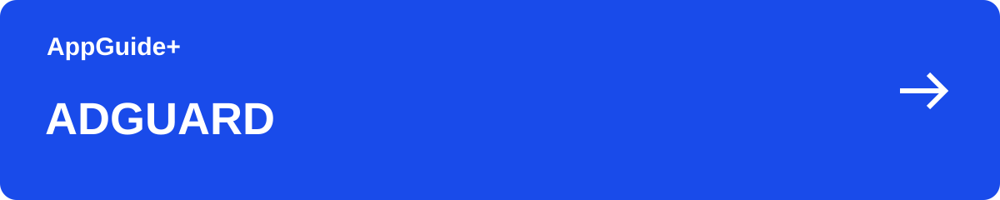

[이 분야의 안내](README.md) · [AppGuide+](https://github.com/appguideplus/app-guides#readme)

# AdGuard 광고차단: 무료 확장 프로그램과 유료 앱 선택

브라우저에서만 광고를 줄이고 싶다면 확장 프로그램부터 살펴보세요. 다른 앱까지 관리하려면 사용하는 운영체제에 맞는 AdGuard 앱을 비교하면 됩니다.

**[웹사이트에서 안내 보기 →](https://appguideplus.com/ko/adguard/?utm_source=github)**

일부 웹 안내에는 제휴 링크가 포함됩니다. 해당 링크를 통한 구매·가입으로 운영자가 수수료를 받을 수 있습니다. AppGuide+는 독립 가이드입니다.

---

## 어디에서 광고를 줄이고 싶나요?

| 상황 | 선택 | 확인할 내용 |
| --- | --- | --- |
| 브라우저 안에서 | 무료 브라우저 확장 프로그램 | 설치한 브라우저의 웹 페이지에서 광고와 추적 요소를 차단합니다. |
| 기기용 앱으로 | 운영체제별 AdGuard 앱 | Windows·Mac·Android·iOS 제품의 차단 범위와 기능을 확인하세요. |

<strong>핵심 정보</strong>

## 핵심 정보

| 항목 | 내용 |
| --- | --- |
| 무료 선택지 | 브라우저 확장 프로그램 |
| 구매 기준 | 운영체제와 사용할 기기 수 |
| 제품 구분 | Ad Blocker · VPN · DNS |

<strong>라이선스를 고르기 전에</strong>

## 라이선스를 고르기 전에

PC와 휴대폰에서 함께 쓸 계획이라면 필요한 기기 수를 먼저 세어 보세요. 결제 화면에서는 라이선스의 사용 기기 수와 이용 기간을 함께 비교하면 됩니다.

AdGuard Ad Blocker와 AdGuard VPN은 서로 다른 제품입니다. 광고차단이 목적이라면 구매하려는 상품명이 Ad Blocker인지 확인하세요.

<strong>이용 순서</strong>

## 이용 순서

1. 사용하는 브라우저 또는 운영체제의 공식 제품 페이지를 엽니다.
2. 무료 확장으로 필요한 범위를 해결할 수 있는지 확인합니다.
3. 유료 앱이 필요하면 기기 수·이용 기간·결제 총액을 비교한 뒤 공식 안내대로 설치합니다.

<strong>기기별 설치 선택</strong>

## 기기별 설치 선택

| 기기·설치 형식 | 설치 안내 |
| --- | --- |
| Windows 설치 파일 (.exe) | [해당 기기의 설치 링크](https://appguideplus.com/ko/adguard/setup/?utm_source=github#downloads) |
| Mac 설치 파일 (.dmg) | [해당 기기의 설치 링크](https://appguideplus.com/ko/adguard/setup/?utm_source=github#downloads) |
| Android 설치 파일 (.apk) | [해당 기기의 설치 링크](https://appguideplus.com/ko/adguard/setup/?utm_source=github#downloads) |
| iPhone·iPad 설치 안내 | [해당 기기의 설치 링크](https://appguideplus.com/ko/adguard/setup/?utm_source=github#downloads) |
| Android TV 설치 파일 (.apk) | [해당 기기의 설치 링크](https://appguideplus.com/ko/adguard/setup/?utm_source=github#downloads) |

운영체제용 앱과 브라우저 확장은 적용 범위가 다릅니다. 연결한 웹 안내의 설치 링크는 제휴 링크이며, 이용에 따라 AppGuide+ 운영자가 수수료를 받을 수 있습니다.

<strong>자주 묻는 질문</strong>

## 자주 묻는 질문

### 무료 확장만으로 휴대폰의 모든 앱 광고가 없어지나요?

브라우저 확장은 해당 브라우저 안에서 동작합니다. 다른 앱의 광고차단은 운영체제와 제품별 지원 범위를 확인하세요.

### 할인코드 없이도 사용할 수 있나요?

무료 확장은 할인코드가 필요 없습니다. 유료 상품은 공식 구매 화면의 가격과 라이선스 조건으로 선택할 수 있습니다.

<strong>단계별 가이드</strong>

## 단계별 가이드

- [AdGuard 시작하기: 브라우저 확장과 앱을 고르는 순서](adguard-setup.ko.md)
- [AdGuard를 켜면 사이트가 안 열릴 때](adguard-troubleshooting.ko.md)

<strong>함께 볼 안내</strong>

## 함께 볼 안내

- [AdGuard VPN 사용법: 광고차단 앱과의 차이·함께 사용하기](adguard-vpn.ko.md)
- [AdGuard DNS 설정: 무료 공개 DNS와 개인용 DNS 비교](adguard-dns.ko.md)
- [NordVPN 요금제 선택: 결제 기간·갱신·기기 수 안내](https://github.com/appguideplus/vpn-security-guides/blob/main/nordvpn.ko.md)
- [Surfshark 요금제: Starter·One 선택과 기기 연결 안내](https://github.com/appguideplus/vpn-security-guides/blob/main/surfshark.ko.md)

<strong>출처와 확인일</strong>

## 출처와 확인일

- [무료 확장과 운영체제별 제품](https://adguard.com/en/adguard-browser-extension/overview.html)
- [기기 수와 라이선스](https://adguard.com/en/license.html)

내용 확인일: 2026-09-12. GitHub판 편집일: 2026-09-14.

AppGuide+가 작성한 독립적인 이용 안내이며, 각 서비스의 공식 고객지원 문서는 아닙니다.

---

[웹 안내로 이어가기](https://appguideplus.com/ko/adguard/?utm_source=github) · [다른 안내 고르기](README.md)

읽기 구성 정리: 2026-10-23.
